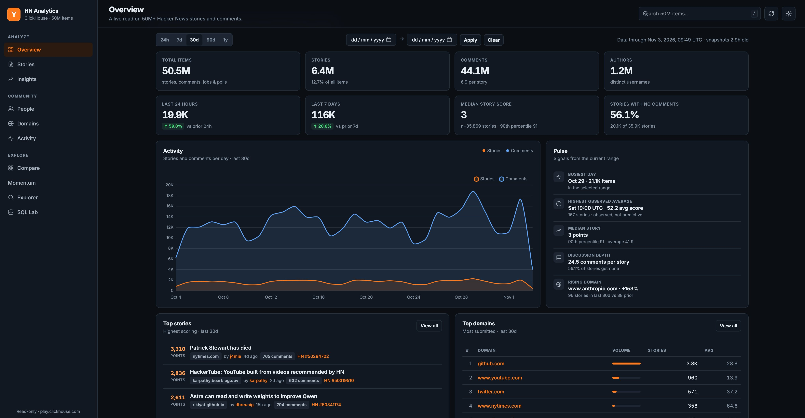
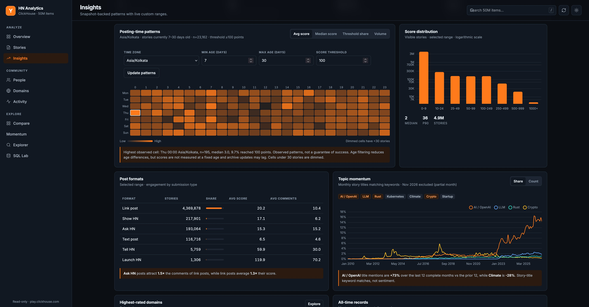
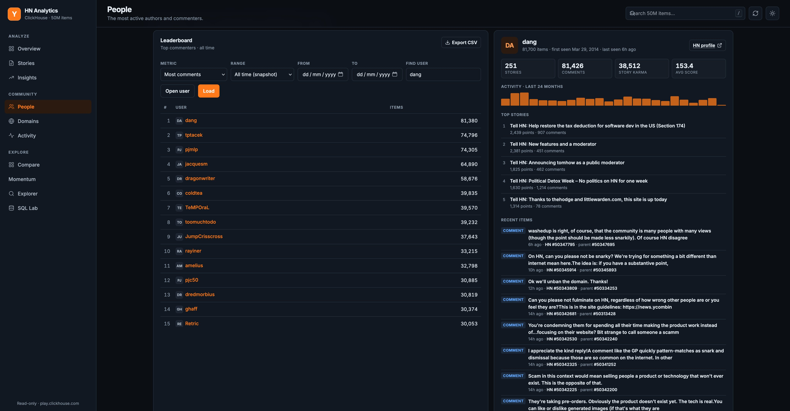
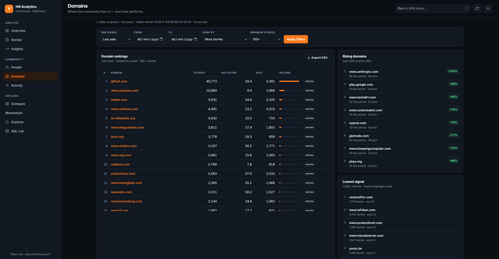
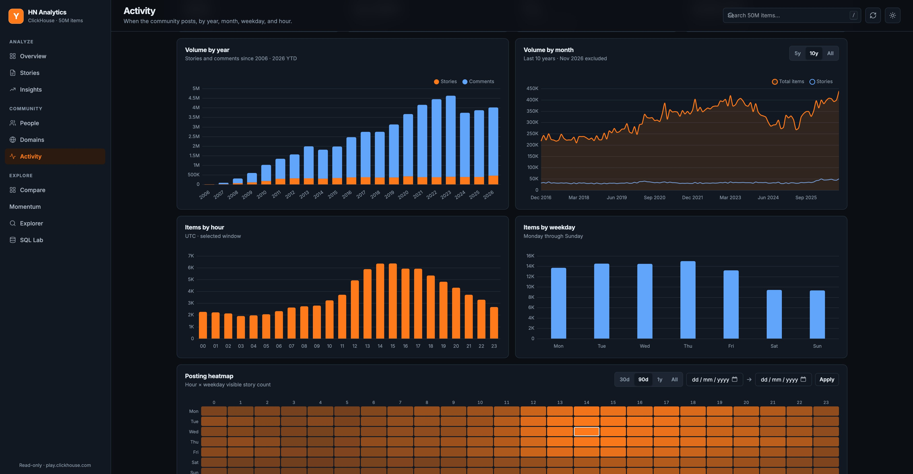

# HN Analytics Dashboard

> Fully vibe-coded frankestein slop built by **muse-spark-1.3** (>80%), **deepseek-v4.1-flash-1017** (~15%) and a bit of **sol-6.1-high** (remaining).

Single-page public analytics dashboard for Hacker News, backed live by
the free **play.clickhouse.com** ClickHouse instance (`hackernews_history`,
~50M rows). No pip packages, no build step, no API key.

Public repo: **https://github.com/freakynit/hackernews-analytics**

## Screenshots

<table>
  <tr>
    <td width="50%"><br />Overview</td>
    <td width="50%"><br />Insights</td>
  </tr>
  <tr>
    <td width="50%"><br />People</td>
    <td width="50%"><br />Domains</td>
  </tr>
  <tr>
    <td colspan="2" align="center"><br />Activity</td>
  </tr>
</table>

## Quick start

```bash
git clone https://github.com/freakynit/hackernews-analytics.git
cd hackernews-analytics
python3 server.py --port 8000
# first run builds data/snapshots/*.json automatically (≈12s, once)
open http://127.0.0.1:8000
```

Python 3.9+ (stdlib only). The dashboard is read-only against ClickHouse.

## Refresh the snapshotted statistics

The heavy historical aggregates are pre-computed and stored in
`data/snapshots/*.json`. Refresh them whenever you want the dashboard to reflect
the latest data:

```bash
python3 refresh_stats.py
```

The server reads the files directly, so **no restart is needed** — reload the
page (front-end API cache is ~60s). Useful options:

```bash
python3 refresh_stats.py --status        # ages and row counts of every snapshot
python3 refresh_stats.py --list          # list snapshot jobs
python3 refresh_stats.py --only yearly monthly
python3 refresh_stats.py --if-stale 12   # only refresh if oldest data is 12h+ old
python3 refresh_stats.py --json          # machine-readable result
```

Optional cron (every 6 hours):

```cron
0 */6 * * * cd /path/to/hackernews-analytics && python3 refresh_stats.py --if-stale 5 >> refresh.log 2>&1
```

## What is pre-computed vs live

| Layer | Detail |
|---|---|
| Live source | `https://play.clickhouse.com/?user=play` — simple POST, `default_format=JSON` |
| Snapshots (`data/snapshots/`) | totals, 24h/7d deltas, yearly & monthly volume, score distribution, best-time heatmap, post formats, topic momentum, domain quality/rising, leaderboards, all-time records |
| On-the-fly (120s memory TTL) | overview KPIs, timeseries, top stories, top users/domains for arbitrary ranges, heatmaps, search, user/item pages, SQL Lab. Any custom `from`/`to` date range bypasses snapshots and queries ClickHouse live |
| Safety | SQL Lab accepts only `SELECT/WITH/SHOW/DESCRIBE/EXPLAIN` touching `hackernews_history`, with a 1,000-row cap |
| Versions | the table is append-only history (`ReplacingMergeTree ORDER BY id`): search deduplicates with `FINAL` before filtering, counting and pagination, with a deterministic id tie-breaker. Other older listings over-fetch and collapse versions; legacy aggregate snapshots can carry version noise. New comparisons, posting patterns and heatmaps use `FINAL`. Comment scores are not present in the archive (they read as 0), so score analytics are story-only |

## Date filters

Every data view accepts preset ranges plus custom `from`/`to` dates
(`YYYY-MM-DD`). All-time views read from `data/snapshots/`; any custom or
relative range runs a live ClickHouse query (120s cache):

| Tab | Filter behavior |
|---|---|
| **Overview** | 24h / 7d / 30d / 90d / 1y presets or custom `from` → `to`; trend, top lists, medians and best-window all follow the selected range |
| **Stories** | Last 24h / 7d / 30d / 90d / 1y / all time or custom dates; custom ranges always query live |
| **Insights** | All time (snapshots) by default; any preset or custom range recomputes every dataset live |
| **People** | All time (snapshot) or 30d / 90d / 1y / custom live leaderboard |
| **Domains** | 30d / 90d / 1y / all time or custom live ranking; rising / lowest-signal side cards stay snapshot-backed |
| **Activity** | Heatmap supports 30d / 90d / 1y / all or custom live range; yearly/monthly stay snapshot-backed |
| **Explorer** | Full-text search with optional custom `from`/`to` dates |

Filters are reflected in the URL hash, so views are shareable
(`#stories?days=7`, `#stories?from=2023-01-01&to=2023-12-31`,
`#explorer?q=rust&from=2024-01-01`).

## Frontend

| Tab | Highlights |
|---|---|
| **Overview** | KPI cards with prior-period deltas, activity trend, auto-generated pulse, top stories and domains |
| **Stories** | Sort/range/format filters, CSV export, external article links + HN discussion links |
| **Insights** | Best time to post (weekday × hour), score distribution, Ask/Show/link format performance, topic momentum, highest-rated domains, all-time records |
| **People** | Most stories / story karma / most comments, all-time or recent; user profiles with activity sparkline, top stories, recent items, HN profile link |
| **Domains** | Domain rankings with avg/max score, rising domains, lowest-signal domains, “view stories” filter links |
| **Activity** | Yearly/monthly volume, hour/weekday bars, volume heatmap |
| **Explorer** | Full-text search across titles/comments/URLs, pagination, item/thread viewer with parent and HN links |
| **SQL Lab** | Example queries, `Ctrl/⌘ + Enter` shortcut, URL-linkified cells, CSV export, schema reference |

Every entity is linkable: articles open externally, domains open externally with
a one-click “stories” filter, usernames open an in-dashboard profile plus the HN
profile, items/comments/parents open the thread viewer or HN, and URLs in SQL
results are clickable. Tabs and filters use the URL hash, so views are
shareable (`#people?user=dang`, `#explorer?q=rust`, `#stories?q=github.com`).
Light/dark theme is persisted in `localStorage`.

## Analytics

Pageviews are tracked per tab (`/#overview`, `/#stories`, …) via
[Umami](https://a.jerrysniffs.online) (`data-auto-pageview="false"` with manual
`umami.track()` on view change, since hash routing is invisible to the default
tracker). Feature usage is tracked as custom events: `explorer-search`
(type/sort/filters), `sql-run` (row count), `compare-run` (cohort kinds),
`csv-export` (file/rows), `theme-toggle`, `user-open`, and `thread-open`.

## API

- `GET /api/health` — ClickHouse connectivity check
- `GET /api/status` — health, totals, snapshot ages, oldest snapshot
- `GET /api/overview?days=30&from=&to=` — KPIs, deltas, series, pulse inputs, top lists
- `GET /api/timeseries?days=&granularity=hour|day|month&from=&to=`
- `GET /api/top-stories?sort=score|discussed|recent&days=&limit=&q=&kind=all|link|text|ask|show&from=&to=`
- `GET /api/top-users?kind=submitters|commenters|karma&limit=&days=&from=&to=`
- `GET /api/top-domains?limit=&days=&metric=count|avg_score|max_score|comments&min_posts=&from=&to=`
- `GET /api/heatmap?days=&from=&to=` (0 = all-time snapshot)
- `GET /api/insights?days=&from=&to=` — snapshots when all-time, live queries otherwise
- `GET /api/search?q=&type=&sort=&limit=&offset=&from=&to=&author=&domain=&min_score=&min_comments=&as_of=`
- `GET /api/compare?a_kind=topic&a_value=Rust&b_kind=topic&b_value=Go&a_from=2026-01-01&b_from=2026-01-01&threshold=100` (each side accepts `domain|topic|user|dates`, value, from and to)
- `GET /api/posting?days=365&from=&to=&tz=Asia/Kolkata&min_age=7&max_age=30&threshold=100`
- `GET /api/replies?parent=1&offset=0` — paged, current-version replies
- `GET /api/momentum` · `GET /api/momentum?id=123` — measured gains / stored observations
- `GET /api/user/<name>` · `GET /api/item/<id>`
- `GET /api/snapshots`
- `POST /api/sql` `{"sql":"SELECT …"}`

## Files

```
server.py             HTTP server, ClickHouse proxy, API, snapshot reader/writer
refresh_stats.py      standalone snapshot refresher (recommended for cron)
index.html            the entire frontend (CSS + JS inline, Chart.js CDN)
data/snapshots/       generated snapshot JSON (safe to delete; rebuilt on start)
data/cache/           legacy cache from the previous version (unused)
```

## Run options

```bash
python3 server.py --port 8000       # build missing snapshots, then serve
python3 server.py --warm-cache      # force-refresh all snapshots before serving
python3 server.py --no-warm         # never build snapshots on startup
```

`HOST`/`PORT` env vars are honored too (`--host`/`--port` flags win).
The server binds `0.0.0.0` by default and exposes a lightweight
`GET /healthz` (no ClickHouse dependency) for container probes.

## Docker and k3s

```bash
docker build -t hn-analytics .
docker run -p 8000:8000 hn-analytics
```

Pushing to `main` builds `ghcr.io/freakynit/hackernews-analytics:latest`
(plus a `sha-*` tag) via `.github/workflows/docker.yml`.
The cluster manifest lives in the infra repo at
`k3s-vps/hackernews-analytics/workload.yaml` (`apps` namespace, plain-HTTP
Ingress for `hackernews-analytics.jerrysniffs.online` behind Cloudflare).
For a release, update the pinned image tag there and reapply:

```bash
kubectl --context k3s-vps apply -f hackernews-analytics/
kubectl --context k3s-vps -n apps rollout status deployment/hackernews-analytics
```

## Freshness and research tools

Every data view has an expandable source indicator, with snapshot names and real
retrieval timestamps preserved through both cache layers. Mixed views list their
individual sources. `X-Data-Provenance` carries this information in API responses
without changing existing list payloads. Retrieval time is not archive coverage:
ClickHouse can lag the HN API. Legacy aggregate snapshots may retain version noise.
Heatmaps count visible stories consistently for live ranges and all-time snapshots.
Regenerate an existing heatmap snapshot with `python3 refresh_stats.py --only best_time`.

Explorer supports exact author/domain filters, minimum story scores/comment counts,
and safely highlighted literal matches. Score sorting selects stories; comment scores
are unavailable. Search pages use current versions before counting or offsetting,
with an id tie-breaker and a fixed submission-time cutoff (`as_of`). This excludes
new submissions while paging; updates to existing scores/deletion status can still
move results. Change filters or start a new search to reset the cutoff.

Comparison cohorts have independent inclusive UTC date ranges (default: current year
in the UI; last 365 days for API callers). Topic matches are literal title substrings,
so `Go` also matches longer words. Cohorts can overlap. Empty cohorts show no score or
engagement estimate. Posting patterns offer IANA time zones (including DST and half-hour
offsets), median scores, sample sizes, and threshold shares, restricted by a selectable
current story age band. These are observed associations, not predictions or scores at
an identical observation age. A past date range outside that age band returns no rows.

Threads load replies as you expand comments, with pagination for large sibling groups.
Thread search covers loaded comments and preserves matching ancestor paths; author
highlighting uses exact names. Each comment links to its original HN page. Story views
list up to 100 other submissions of the same URL, ignoring scheme, `www`, fragments
and trailing slashes while retaining query parameters; redirects, tracking variants,
and different article URLs are not inferred to be equivalent.

## Collect story momentum

Start the optional local collector to record actual HN API observations going forward:

```bash
python3 collect_momentum.py                 # every 5 minutes, until stopped
python3 collect_momentum.py --once          # suitable for a 5-minute cron job
python3 collect_momentum.py --interval 600
```

Observations persist in `data/momentum.sqlite3` (SQLite WAL). The collector samples
the top 100 and newest 100 stories and follows sampled stories for 48 hours. It does
not assume archive versions provide a historical time series. Momentum ranks positive score
gains per elapsed hour between the first and last recorded observations in the past
24 hours, requiring a span of at least five minutes. Select a story to chart measured
scores and comment counts. Until paired samples exist, the view explains its empty
state. Collection gaps, selection bias, and missed early activity remain visible
limitations. No background collector is started by the dashboard itself.

## Notes for contributors

Generated runtime data is gitignored and never committed:

- `data/snapshots/*.json` — rebuilt automatically on server start
  (or via `python3 refresh_stats.py`)
- `data/cache/` — legacy cache, unused
- `data/momentum.sqlite3*` — local collector observations

So a fresh clone starts clean and builds what it needs on first run.

## Contributing

Issues and pull requests are welcome at
https://github.com/freakynit/hackernews-analytics.

1. Fork the repo, create a branch, make the smallest change that works.
2. This project is stdlib-only Python 3.9+ with no test suite — please keep it
   that way unless there's a strong reason, and manually verify
   `python3 server.py` and any touched API endpoint.
3. Update this README if your change affects setup, API, or behavior.

## License

MIT — see [LICENSE](LICENSE).

## Acknowledgements

- Data: [Hacker News](https://news.ycombinator.com) via the public
  [play.clickhouse.com](https://play.clickhouse.com) `hackernews_history`
  archive and the official [HN API](https://github.com/HackerNews/API).
- Frontend charting: [Chart.js](https://www.chartjs.org) via CDN.
